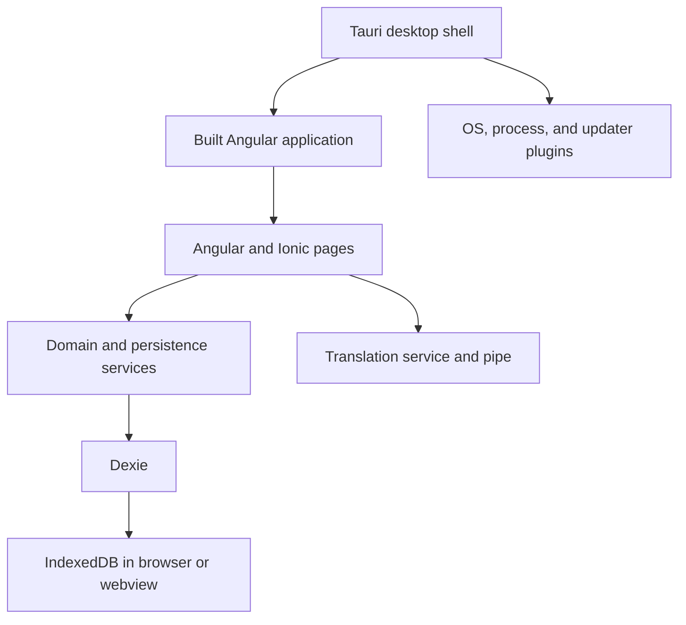
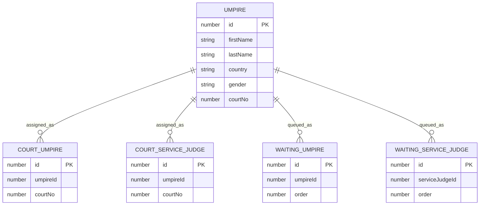

# Architecture

This document describes behavior confirmed from the current repository. Proposed changes should be labeled as proposals rather than added here as existing behavior.

## System overview

Court Pilot is a local-first Angular/Ionic application packaged as a Tauri desktop application. There is no backend API in the repository. Domain data is persisted in IndexedDB through Dexie.

## Frontend structure

The root route lazy-loads the tab routes. The three primary routes are:

| Route | Source | Responsibility |
|---|---|---|
| `/tabs/pilot` | `src/app/tab1/` | Waiting queues, court assignments, drag and drop, and rotation actions |
| `/tabs/umpires` | `src/app/tab2/` | Court-official roster management |
| `/tabs/settings` | `src/app/tab3/` | Court count, theme, service-judge mode, alerts, and language |

Pages are standalone Angular components and directly import the Ionic standalone components they use. Services are root-provided and injected with Angular's `inject()` function.

## Reactive state

Persistence services use Dexie's `liveQuery()` and Angular's `toSignal()` to expose reactive data. Pages derive lookup maps, ID sets, filtered lists, and other display state with `computed()`.

`Tab1Page` currently coordinates multi-service operations such as moving officials between waiting queues and courts. These operations span multiple Dexie tables but are not currently wrapped in database transactions.

## Persistence model

`db.ts` declares a `CourtPilot` Dexie database at schema version 1.

Settings use a singleton row with ID `1`. Defaults are five courts, service judges enabled, and confirmation alerts enabled.

Theme preference is stored separately in `localStorage` under `theme`, using
`light`, `dark`, or `system`. Device-preferred (`system`) is the default when no
valid preference exists. `ThemeService` restores the selection when the root
component starts and toggles Ionic's `ion-palette-dark` class. Device theme changes
apply while the app is open when device-preferred is selected. This does not
change the Dexie schema or existing settings records.

### Schema-change policy

Once data may exist in released clients, do not modify schema version 1 in place. Add a new `db.version(n)` declaration and define upgrade behavior when existing records need transformation.

## Localization

`src/app/i18n/translations.ts` defines the translation catalog and derives TypeScript types from it. English is the fallback language; Hungarian is also supported. The selected language is stored in `localStorage` under `language`.

Templates use `TranslatePipe`. Imperative UI such as Ionic alerts uses `TranslationService`.

## Desktop integration

The Tauri shell loads the Angular build from `www/`. Its Rust layer registers:

- OS plugin
- process plugin
- updater plugin
- debug-only logging plugin

At application startup, the Angular root component checks for desktop updates when running under Tauri. It skips the in-app updater on Linux because Snap manages Linux updates.

Windows and macOS updater artifacts are distributed through CrabNebula. Linux is packaged and published as a strict-confinement Snap.

## Supported platforms

The supported targets are browser/web, Windows, macOS, and Linux Snap. Android and iOS are not supported or planned at this stage. `capacitor.config.ts` remains as possible future scaffolding, but agents must not treat mobile builds as active.

Tauri development intentionally expects the Ionic frontend on port `8103`. The command used by `beforeDevCommand` must explicitly or otherwise reliably start the frontend on that port.

## Domain invariants affecting architecture

Each court official must be represented in exactly one operational state: not on duty, one waiting queue, or one court assignment. The two role queues are FIFO by numeric `order`. When service judges rotate off a court, the officials swap role queues. Reducing the court count removes assignments from eliminated courts and leaves those officials not on duty.

Operations that move an official between states should preserve exclusivity even when multiple Dexie tables are involved.

## Known architectural questions

- Should moves spanning multiple tables use Dexie transactions to prevent partial updates?
- Should domain entities and database setup remain in root-level `db.ts`, or move under `src/app/`?
